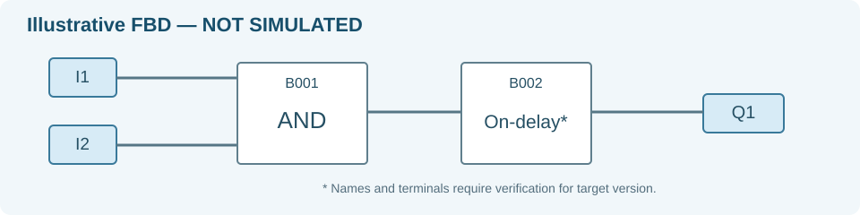

# Siemens LOGO! Master

**A Claude-compatible Agent Skill for Agent Zero** for beginner-friendly Siemens LOGO! Soft Comfort FBD design, explanation and documentation in Dutch.



> Independent project. Not affiliated with Siemens. Diagrams and examples are illustrative, not verified PLC programs.

## Features

- Version-aware research using official Siemens documentation
- Real, verified function-block names, parameters, and terminal labels
- Clearly numbered PLC inputs (I1…), outputs (Q1…) and blocks (B001…)
- Pin-to-pin instructions understandable by beginners
- Manual/automatic control priorities, interlocks, startup and edge-case review
- Landscape A4 FBD PDF reports, legends, I/O tables, test cases and version history
- Explicit distinction between assumed, theoretically reviewed and actually simulated

## Agent Zero installation

Use an **import-ready ZIP with SKILL.md at archive root**. In Agent Zero: **Skills → Import → Scan Skills → Preview → Import**. Select namespace `siemens-logo-master`.

For manual installation copy `SKILL.md`, `references/`, `scripts/`, and `assets/` to `/a0/usr/skills/siemens-logo-master/`, subject to your A0 deployment path.

**Note:** GitHub's automatic "Download ZIP" wraps the repository in a parent directory and may not import directly as a skill. To make an import-ready archive from a clone, run `python scripts/package_skill.py`.

## Claude compatibility

Uses the conventional `SKILL.md` YAML frontmatter with `name` and `description`, plus supporting reference and script directories. Copy the skill directory into a supported Claude skill environment.

## PDF generation

Install Python and ReportLab:

```bash
python -m pip install -r requirements.txt
python scripts/validate_skill.py
python scripts/render_report.py assets/example_circuit.json example.pdf
python scripts/package_skill.py
```

The ReportLab renderer generates a **technical illustration**, not a genuine Siemens LOGO! Soft Comfort export or native `.lsc` project. Do not claim simulations occurred unless run in the actual Siemens software.


## Project files

- [SKILL.md](SKILL.md) — AI skill entrypoint and mandatory engineering workflow
- [references/](references/) — verification, design and documentation guidelines
- [scripts/](scripts/) — validation, PDF renderer and ZIP packager
- [assets/example_circuit.json](assets/example_circuit.json) — illustrative input for PDF generation

## Safety

PLC control diagrams are not substitutes for tested electrical designs, electrical interlocks, risk assessments or machine-safety measures. Test circuits against the target hardware/software before real operation.

## License

MIT for original content; Siemens trademarks and documentation remain with their owners.